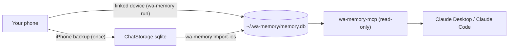

# wa-memory

Your whole WhatsApp history in one local, searchable store on your computer, which Claude can read through a
read-only MCP server. Your messages stay on your machine.

- **Whole history:** wa-memory links itself as a WhatsApp device and keeps every new message, and can import
  years of older chats from an iPhone backup. The two are merged by message ID, with no duplicates.
- **Search that understands your language:** "sedinta" finds "Ședința", "contract" finds "contractul".
- **Attachments:** documents become searchable text; voice notes are transcribed on your computer (whisper.cpp);
  pictures are shown to Claude when it asks.
- **Read-only:** there is no command or tool that sends, edits, deletes or marks anything as read in WhatsApp.

> [!WARNING]
> **WhatsApp does not allow unofficial clients.** wa-memory connects as a linked device using
> [whatsmeow](https://github.com/tulir/whatsmeow) (through its Python bindings,
> [neonize](https://github.com/krypton-byte/neonize)), the same protocol WhatsApp Web uses. WhatsApp can restrict
> or ban a number that uses unofficial software, even one that only reads. wa-memory never sends messages or read
> receipts and marks itself offline, but **the risk is not zero and it is yours**. Do not use it
> on a number you cannot afford to lose. This project is not affiliated with, endorsed by or connected to
> WhatsApp or Meta.



## Requirements

- macOS (the background jobs use launchd; see [Linux](#linux) for what works elsewhere)
- Python 3.11 or newer (macOS's built-in Python is 3.9: use [uv](https://docs.astral.sh/uv/), pipx with a
  Homebrew Python, or similar)
- Optional, for voice notes: `brew install whisper-cpp ffmpeg` and a whisper model (see [Voice notes](#voice-notes))

## Install

```sh
uv tool install "wa-memory[pdf] @ git+https://github.com/corneliu10/wa-memory"
# or: pipx install "wa-memory[pdf] @ git+https://github.com/corneliu10/wa-memory"
```

The `pdf` extra reads PDF documents; without it, PDFs are kept but not read.

## 1. Link WhatsApp

```sh
wa-memory link                      # shows a QR code in the terminal
wa-memory link --phone +40700000001 # or: a code you type on the phone
```

On your phone: WhatsApp → Settings → Linked devices → Link a device, and scan the code (or choose "Link with
phone number instead" and type the code). The device shows on your phone as "wa-memory" (set
`WA_MEMORY_DEVICE_NAME` to change it). wa-memory asks the phone for as much history as it will send (up to
10 years / 2 GB; phones often send a few years).

On macOS it then starts two background jobs: one stays connected and writes new messages into the memory as
they arrive, the other reads new documents and voice notes every 5 minutes. Check them with
`wa-memory service status`; stop them with `wa-memory service uninstall`.

## 2. Import your whole history from an iPhone backup (optional)

The linked device only gets what the phone sends. An iPhone backup has everything.

1. Make an **unencrypted** backup in Finder (General → Back up all the data on your iPhone to this Mac).
   Encrypted backups are not supported yet.
2. Give your terminal Full Disk Access (System Settings → Privacy & Security), so it can read the backup folder.
3. Import it:

```sh
wa-memory import-ios ~/Library/Application\ Support/MobileSync/Backup/<backup folder>
wa-memory import-ios <path> --business      # for WhatsApp Business
```

The backup is opened read-only and never changed.

## 3. Connect Claude

**Claude Code:**

```sh
claude mcp add --scope user wa-memory -- wa-memory-mcp
```

**Claude Desktop:** add this to `~/Library/Application Support/Claude/claude_desktop_config.json`, with the
full path that `which wa-memory-mcp` prints, then restart Claude Desktop:

```json
{ "mcpServers": { "wa-memory": { "command": "/full/path/to/wa-memory-mcp" } } }
```

Then ask, for example: "What did my accountant send me about the 2025 taxes?" or "Who is waiting for a
reply from me?"

### Tools Claude gets

| Tool | What it does |
| --- | --- |
| `whatsapp_search` | Search all messages, document text and voice-note transcripts |
| `whatsapp_list_chats` | Chats by last activity |
| `whatsapp_read_chat` | A conversation in time order, page by page |
| `whatsapp_person` | Everything about one person: first and last contact, who wrote how much, the groups they write in, latest messages |
| `whatsapp_waiting_on_me` | Chats where the last message is someone else's |
| `whatsapp_digest` | What happened since a time (default the last 24 hours) |
| `whatsapp_list_attachments` / `whatsapp_get_attachment` | Find files; show a picture, read a document, transcribe a voice note |
| `whatsapp_stats` | What the memory holds, and whether the link is connected |

Every answer tells Claude that message text is other people's data, not instructions.

## What the linked device does on the network

- It talks to WhatsApp only: the WhatsApp Web servers, and WhatsApp's media servers when it downloads an
  attachment. wa-memory has no telemetry and contacts no other host. (neonize ships its compiled engine inside
  its macOS and Linux packages; only where a package lacks it does neonize download it once from neonize's own
  GitHub releases.)
- It acknowledges delivery of messages (the second grey tick), as every linked device does. It never sends
  read receipts (blue ticks) and never sends messages. It marks itself offline so your phone keeps its
  notifications; WhatsApp accepts that once your account name has synced, which can take a few minutes after
  linking, and wa-memory retries until it does. Opening an attachment downloads it straight from WhatsApp's media servers; nobody is notified.

## Privacy

- Everything lives in `~/.wa-memory` (folder 0700, files 0600): `memory.db` (the messages), `session.db` (the
  linked device's keys), `media/` and `logs/`. **Anyone with a copy of `session.db` can act as this linked
  device** until you remove it on your phone; computer backups include it.
- Claude sees what you ask it about, under your Claude account's terms.
- **Keep chats out:** list them in `~/.wa-memory/exclude.txt`, one per line (a chat ID such as
  `40700000001@s.whatsapp.net`, or an exact chat or contact name). Within a minute (and whenever Claude starts
  wa-memory) they are removed from the memory and never stored again.
- **Deletions are respected:** a message its author deletes for everyone is removed from the memory (with its
  file), and a later history sync or backup import does not bring it back. Only the author's own deletions and
  edits are applied; nobody else can remove or rewrite a message in your memory.
- **Remove everything:** `wa-memory service uninstall`, delete `~/.wa-memory`, and remove the device on your
  phone (WhatsApp → Settings → Linked devices).

## Command line

```text
wa-memory link [--phone +NUMBER]  link this computer as a WhatsApp device, then start the background jobs
wa-memory run                     stay connected and keep the memory up to date (what the background job runs)
wa-memory service [ACTION]        install | uninstall | status (macOS)
wa-memory import-ios PATH         import an iPhone backup
wa-memory fetch-media             read new documents and voice notes now
wa-memory search WORDS...         search (JSON)
wa-memory waiting [DAYS]          chats waiting on your reply
wa-memory stats                   what the memory holds
```

Settings by environment variable: `WA_MEMORY_HOME` (default `~/.wa-memory`), `WA_MEMORY_DEVICE_NAME`,
`FFMPEG_BIN`, `WHISPER_BIN`, `WHISPER_MODEL`.

## Voice notes

Transcription runs on your computer with whisper.cpp. Install `whisper-cpp` and `ffmpeg`, download a model (for
example `ggml-large-v3-turbo-q5_0.bin` from the whisper.cpp model list) to `~/.wa-memory/models/`, or point
`WHISPER_MODEL` at it. Voice notes that arrived before the model was there are transcribed once it is.

## Linux

The link, the memory, the iPhone import, search and the MCP server are plain Python and should work; they are
not tested on Linux yet. Not built there: the background jobs (run `wa-memory run` as a systemd user service and
`wa-memory fetch-media` from a timer), and Word/RTF conversion and picture resizing (they use macOS's
`textutil` and `sips`).

## Known limits

- WhatsApp keeps attachment files on its servers for a few weeks only; older files need the phone or a backup.
- Encrypted iPhone backups and Android backups are not supported yet.
- Messages that arrived before wa-memory was linked are only as complete as the history the phone sends.
- No meaning-based (semantic) search yet.

## Development

```sh
python3 -m venv .venv && .venv/bin/pip install -e ".[pdf]"
.venv/bin/python -m unittest discover -s tests -v
```

The tests use made-up chats and files only, and never connect to WhatsApp. Never commit real message data:
`*.db` files are ignored.

## License

MIT. See [LICENSE](LICENSE). Uses [neonize](https://github.com/krypton-byte/neonize) (Apache-2.0) and
[whatsmeow](https://github.com/tulir/whatsmeow) (MPL-2.0), which neonize bundles.
